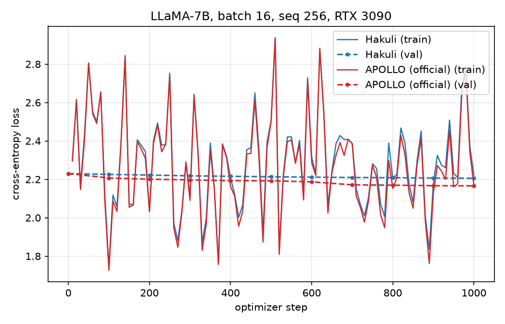

# Hakuli: An Independent Clean-Room Implementation and Reproducibility Study of APOLLO

*Memory-Efficient LLM Training on a Single Consumer GPU*

**Evaristo Cordoba Ancajima** — XAEDRO · research@xaedro.com

October 2026

---

## Abstract

We present **Hakuli**, an independent, clean-room implementation of the APOLLO optimizer (Zhu et al., MLSys 2025) released under the Apache License 2.0. Hakuli makes *no claim of algorithmic novelty*: the method follows the published APOLLO specification, which in turn builds on the low-rank gradient projection of GaLore (Zhao et al., ICML 2024) and the norm-growth limiter of Fira (Chen et al., NeurIPS 2025). Our contributions are: (i) a self-contained, PyTorch-only implementation with no additional runtime dependencies, written from the published description without using reference source code; (ii) a reproducibility study of APOLLO's memory and performance claims on consumer hardware; (iii) a black-box comparison against the official `apollo-torch` package under an identical protocol and matched hyperparameters, in which the two implementations track each other within a mean absolute difference of 0.028 nats across logged training-loss observations over a 1000-step run; and (iv) measured full-parameter training of a 7B model at batch size 16, sequence length 256, bf16 with gradient checkpointing, within 24 GiB of peak allocated memory and without quantization. We also document every deviation from the reference formulation and provide all scripts, configs and raw results for reproduction.

**In thirty seconds.** Full-parameter training of 7B language models is normally out of reach on a 24 GiB consumer GPU because AdamW's optimizer state alone needs roughly 54 GB for LLaMA-7B (6.74B parameters x 8 bytes, excluding gradients and master weights). Hakuli tracks Adam-style moments in a low-rank random subspace and applies a channel-wise scaling to the full gradient, reducing optimizer state to a few gigabytes. We rebuilt this method independently from its public specification, verified it against the official implementation in a black-box comparison, and measured 7B training at batch size 16 within 20.5 GiB of peak allocated memory on an RTX 3090. The software is Apache-2.0.

## 1. Introduction

Memory-efficient optimizers have become a practical requirement for full-parameter training of large language models (LLMs) on commodity hardware. AdamW (Loshchilov & Hutter, 2019) maintains two fp32 moments per trainable parameter, 8 bytes per parameter, which amounts to about 54 GB (decimal) for LLaMA-7B's 6.74B parameters, excluding gradients and master weights. Low-rank methods such as GaLore, Fira, APOLLO and Q-GaLore reduce this burden by tracking optimizer statistics in a compressed subspace.

APOLLO received an Outstanding Paper Honorable Mention at MLSys 2025 and is integrated into widely used frameworks. Its official implementation, `apollo-torch`, is released under CC-BY-NC, and the Hugging Face Trainer integration of APOLLO requires that package. For commercial users, this creates a licensing obstacle independent of the method's technical merit.

This paper presents Hakuli, an independent, clean-room implementation of the APOLLO method under Apache-2.0. We emphasize what this work is and is not:

- **Not** a new optimizer. The update rule follows APOLLO's published specification. We explicitly reject any framing of Hakuli as an algorithmic invention.
- **An** independent implementation: single file, PyTorch-only, no reference source code consulted, numerically validated against a specification-derived reference before any official code was executed.
- **A** reproducibility study: we test which of APOLLO's reported memory and performance claims can be independently reproduced on a single 24 GiB consumer GPU, and which cannot be tested with our hardware.
- **A** black-box comparison: identical protocol, same GPU, official `apollo-torch` v1.0.3 versus Hakuli.
- **A** documented set of deviations from the reference formulation (Section 10) and a full reproducibility package.

## 2. Background: APOLLO

We summarize the method as published; notation follows the APOLLO paper.

For a weight matrix with gradient $G_t \in \mathbb{R}^{m \times n}$ and a random projection $P_t \in \mathbb{R}^{m \times r}$ resampled every `update_proj_gap` steps, APOLLO computes a projected gradient $R_t = P_t^\top G_t$ and tracks first and second moments in the projected space:

$$M_t = \beta_1 M_{t-1} + (1-\beta_1) R_t, \qquad V_t = \beta_2 V_{t-1} + (1-\beta_2) R_t^2$$

The Adam-normalized direction in the subspace is $S_t = M_t / (\sqrt{V_t} + \epsilon)$, and a channel-wise scaling factor is obtained from the ratio of norms:

$$s_t = \frac{\lVert S_t \rVert_{\mathrm{dim}}}{\lVert R_t \rVert_{\mathrm{dim}}}, \qquad U_t = \sqrt{\lambda}\, s_t \odot G_t$$

where the norms are taken along the output-channel dimension and $\lambda$ is a heuristic scale. The update is applied to the *full* gradient with a scale-corrected step size:

$$\eta_t = \eta \, \frac{\sqrt{1-\beta_2^t}}{1-\beta_1^t}, \qquad W_t = W_{t-1} - \eta_t U_t$$

A tensor-wise variant (APOLLO-Mini) replaces the channel vector $s_t$ by a scalar and uses rank $r=1$. The norm-growth limiter (NL), adopted from Fira, caps the relative growth of the update norm between consecutive steps and stabilizes training.

The lineage is direct: GaLore introduced low-rank gradient projection with a periodic SVD; Fira introduced norm-based scaling with a norm-growth limiter; APOLLO replaced the SVD with a pure random projection and moved the update back to the full gradient. Hakuli implements this final formulation.

## 3. Clean-Room Methodology

**Implementation provenance.** Hakuli was implemented independently from the published APOLLO algorithmic description (arXiv:2412.05270) and its public documentation. No source code from the official APOLLO implementation was used in the implementation of Hakuli.

Concretely:

- The implementation was written from the mathematical specification and validated numerically against an internal, specification-derived reference implementation before any official code was executed.
- The first execution of the official implementation (`apollo-torch` v1.0.3) took place on 2026-10-09, as a black box, for the comparison reported in Section 6 — after the Hakuli implementation was complete (initial public commit `a8ef673`).
- The official package is used exclusively as an external dependency of the benchmark harness for black-box runs. It is not linked, copied, or redistributed by Hakuli.
- Internal records (dates, commit history, and the development log of the specification-derived validation) are retained by the authors.

This separation of roles — implementation from the specification first, black-box validation against the reference second — is what makes the clean-room claim verifiable in practice.

## 4. Hakuli Implementation

Hakuli is a single-class `torch.optim.Optimizer` subclass with no dependencies beyond PyTorch (>= 2.1). Design choices:

- **Random projection with periodic resampling**, no SVD at any step; the projection is stored in bfloat16.
- **Per-parameter instances with per-layer weight updates.** One optimizer instance per low-rank parameter, stepped from `register_post_accumulate_grad_hook` so gradients are released eagerly. This pattern was introduced in the GaLore codebase and adopted by APOLLO and Q-GaLore; we follow it and cite it as such.
- **Adam-style fallback.** Parameters whose smallest dimension does not exceed the rank, and all 1-D parameters, are updated with a bias-free Adam-style direction. A shared AdamW covers these parameters.
- **Decoupled weight decay**, standard `state_dict` checkpointing, and closure support.
- **Optional loss-memory reduction.** In some memory-constrained training runs we pair Hakuli with Cut Cross-Entropy (Wijmans et al., ICLR 2025), which computes the cross-entropy without materializing the full logit matrix.

Per projected parameter of shape $m \times n$, optimizer state is $2 r \max(m,n)$ bytes (bf16 projection) plus $8 r \min(m,n)$ bytes (two fp32 moments), versus $8mn$ bytes for AdamW fp32 moments. For a 7B transformer at $r=256$ this is approximately 2.4 GB in total.

## 5. Experimental Setup

**Hardware and software.** Single NVIDIA RTX 3090 (24 GiB), PyTorch 2.5.1+cu124, Transformers 4.57.6, Datasets 5.0.1, SDPA attention, gradient checkpointing enabled, bf16 weights and gradients.

**Model and data.** LLaMA-7B (`huggyllama/llama-7b`), trained on streaming C4 with packed sequences. We start from the pretrained weights (continual pretraining); the reported loss is therefore not comparable to from-scratch runs and serves only as a sanity check that training is healthy.

**Protocol (controlled comparison).** Batch size 16, sequence length 256, 1000 optimizer steps, learning rate 1e-5, rank 512, `update_proj_gap` 200, 10 warmup steps, and scale = 1 in both implementations (applied under a square root in both). The official `apollo-torch` (v1.0.3) and Hakuli are run with this identical configuration, identical batches and seed, in the same harness. At aggressive settings (lr = 5e-3, scale = 8) the first optimizer step can substantially perturb the pretrained weights (we observed a loss spike from 2.23 to 12 within ten steps in that regime); the matched comparison therefore uses fine-tuning-scale hyperparameters.

**Measurement.** Peak VRAM is `torch.cuda.max_memory_allocated` after resetting statistics at the end of warmup, so one-time initialization allocations are excluded; values are reported in GiB (powers of 1024), as returned by the CUDA allocator. Throughput is steady-state tokens/second measured over steps after warmup. Training metrics (loss, gradient norm, update norm, peak VRAM, throughput) are logged every 10 steps to JSONL. Validation loss is evaluated on the same 8 fixed held-out batches every 100 steps. Both implementations use the standard causal cross-entropy loss (the same code path); Cut Cross-Entropy is not used in the controlled comparison. Raw JSON results, configs and the harness are included in the repository (`benchmarks/`).

## 6. Reproduction of APOLLO

We attempted to reproduce the reported claims that are testable on a single 24 GiB GPU. The table below summarizes the status.

| APOLLO claim | Status here | Evidence / reason |
|---|---|---|
| 7B pre-training within 11 GB (A100, batch 1) | partially addressed | Different batch size and GPU; we measure at batch 16 on 24 GiB (Section 7). |
| Up to 3x throughput vs. Adam on 4xA100-80GB | not testable | Hardware unavailable. |
| LLaMA-13B with naive DDP on A100-80GB | not testable | Hardware unavailable. |
| 7B under 12 GB combined with quantization | not addressed | Hakuli v1.0 implements no quantization. |
| Structured (channel-wise) scaling matches AdamW-level quality | not tested | No comparable quality baseline or sufficient training in this study. |
| Reproduces the reference optimization trajectory under matched hyperparameters | supported | Mean absolute difference of 0.028 nats across logged training-loss observations over 1000 steps; validation loss within 0.04 nats (figure in Section 6). |

**Controlled comparison.** Under the protocol of Section 5 (matched learning rate, scale, batches and seed), the official `apollo-torch` v1.0.3 and Hakuli produce the training and validation curves of the figure below. Both implementations fit 7B full-parameter training at batch size 16 within 24 GiB: peak allocated memory is 19.44 GiB for the official implementation and 20.51 GiB for Hakuli; throughput is 1041 and 1026 tokens/s respectively, and wall time for 1000 steps is 65.5 and 66.4 minutes. The training losses track closely after warmup (mean absolute difference of 0.028 nats and median of 0.026 across logged observations), and validation loss decreases monotonically in both runs, ending at 2.166 (official) and 2.206 (Hakuli), a residual gap of 0.04 nats. The residual gap is consistent with the documented implementation deviations (Section 10) and the single-seed design; this study does not isolate its cause. The training curves overlap within batch-to-batch noise throughout, including the in-run projection-resample boundaries at steps 200, 400, 600 and 800. This supports the claim that Hakuli reproduces the optimization behavior of the reference implementation under matched hyperparameters.



*Matched-scale comparison on LLaMA-7B (batch 16, sequence length 256, 1000 steps, RTX 3090). Solid lines: training loss, logged every 10 steps. Dashed lines: validation loss on the same 8 fixed held-out batches. Official `apollo-torch` v1.0.3 and Hakuli use identical batches, seed, learning rate and scale.*

## 7. Systems Performance

| Method | GPU | Batch | Rank | State precision | Peak VRAM | Source |
|---|---|---|---|---|---|---|
| AdamW | 24 GiB class | 16 | — | fp32 | does not fit | GaLore paper |
| GaLore-8bit | RTX 4090 | 16 | 1024 | int8 | 22.8 GB | GaLore repo |
| Q-GaLore | A6000 | 16 | 1024 | int4 | 15.26 GB | Q-GaLore repo |
| APOLLO (official) | RTX 3090 | 16 | 512 | bf16/fp32 | 19.44 GiB | this work |
| **Hakuli** | RTX 3090 | 16 | 512 | bf16/fp32 | **20.51 GiB** | this work |

Published anchors are quoted as reported by their authors on different hardware, ranks and state precisions; they are included for context, not as controlled comparisons. The controlled comparison is the last two rows (same protocol, same GPU); our values are GiB as returned by the CUDA allocator.

The controlled rows show that both the official implementation and Hakuli enable LLaMA-7B full-parameter training at batch size 16, sequence length 256, within 24 GiB, without quantization. Hakuli's measured throughput of 1026 tokens/s corresponds to about 4.0 s per optimizer step at 4096 tokens per step.

**Long-context fine-tuning.** In a separate internal run on the same GPU, a 7B model was full-parameter fine-tuned at sequence length 3072, batch size 4, rank 256, using Hakuli with Cut Cross-Entropy, peaking at 23.3 GiB. This shows that the configuration remains feasible at longer context, where activation memory dominates.

## 8. Comparison with Related Methods

Beyond the controlled comparison, we relate Hakuli to the broader family of memory-efficient optimizers:

- **AdamW**: standard full-rank baseline, but optimizer state alone (~54 GB for LLaMA-7B) exceeds consumer GPUs.
- **GaLore**: SVD-based projection; periodic decomposition stalls and degraded stability at small batch sizes are well documented in later work.
- **Q-GaLore**: adds INT4 projection and quantization, reaching 15.26 GB for 7B at batch 16, at the cost of a quantized state.
- **SCALE** (Glentis et al., ICML 2026): a 2026 minimalist design (column-wise gradient normalization plus last-layer momentum) reporting better perplexity and memory than APOLLO for 7B. We cite it as the current state of the art in this line and as future comparison work; it was not benchmarked here.

## 9. Ablations

This version does not include a systematic ablation study. We report the observations we have and mark the rest as planned work:

- **Rank.** Rank 512 at batch size 16 fits 24 GiB (20.5 GiB measured); rank 256 was used in our long-context run (23.3 GiB at sequence length 3072, where activations dominate). A rank sweep at fixed sequence length is planned.
- **Projection interval.** `update_proj_gap`=200 was used in the controlled runs (resample boundaries every 200 steps), 500 in earlier internal runs; no systematic sensitivity analysis yet.
- **Scale.** The heuristic $\lambda \approx \mathrm{hidden}/\mathrm{rank}$ was used in fine-tuning runs; no sweep yet.
- **Precision.** bfloat16 projections were used in all runs; a comparison against fp32 projections is planned.

## 10. Limitations and Deviations from APOLLO

**Limitations.** All controlled results come from a single GPU (RTX 3090) and a single model size (7B); multi-GPU and FSDP behavior of Hakuli is untested. Loss values are reported for protocol sanity, not for quality claims. No quantization is implemented.

**Deviations from the reference formulation.** Hakuli differs from the official implementation in the following, all documented in the code:

1. The projection matrix is stored in bfloat16.
2. The `scale` parameter is applied under a square root ($\sqrt{\lambda}$), matching our validated internal convention.
3. The norm-growth limiter is expressed as a relative cap with a restart when the previous update norm is exactly zero; the official implementation applies the limiter before or after scaling depending on a configuration flag.
4. The Adam fallback applies when $\min(m,n) \leq r$ or the parameter is not 2-D; the reference partitions parameters differently.
5. Per-parameter optimizer instances plus a shared AdamW for non-2-D parameters; the reference supports both single-optimizer and per-layer configurations.
6. No quantization or SVD projection options are implemented.

## 11. Reproducibility Statement

The repository contains the optimizer, a test suite (unit and integration tests, including a guard that no SVD routine is ever called), the benchmark harness, all JSON configs, and the raw result files reported here. Reproduction:

```bash
git clone https://github.com/xaedro-ai/hakuli
pip install -r benchmarks/requirements.txt
python benchmarks/run_benchmark.py --config benchmarks/configs/memory_llama7b_hakuli.json
python benchmarks/table.py
```

The official comparison additionally requires `pip install apollo-torch` (v1.0.3) and the config `memory_llama7b_apollo.json`. Environment: Docker container based on NVIDIA NGC PyTorch 24.10 (`benchmarks/Dockerfile`), Python 3.11. Initial public commit: `a8ef673`.

## 12. License and Provenance

Hakuli is released under the Apache License 2.0, including a patent grant from its contributors over their own contributions. This grants no rights to third-party patents. The official APOLLO implementation is released under CC-BY-NC (with portions from GaLore under Apache-2.0); GaLore and Fira are Apache-2.0. Hakuli is not affiliated with, or endorsed by, the APOLLO authors. Academic attributions are recorded in the repository `NOTICE` file. We thank the APOLLO, GaLore and Fira authors for publishing the method and its documentation, which made this study possible. The official APOLLO implementation was used exclusively as an external black box in the later evaluation phase (Section 3); no part of it is included in Hakuli.

## References

1. H. Zhu, Z. Zhang, W. Cong, X. Liu, S. Park, V. Chandra, B. Long, D. Z. Pan, Z. Wang, J. Lee. *APOLLO: SGD-like Memory, AdamW-level Performance.* MLSys 2025. arXiv:2412.05270.
2. J. Zhao, Z. Zhang, B. Chen, Z. Wang, A. Anandkumar, Y. Tian. *GaLore: Memory-Efficient LLM Training by Gradient Low-Rank Projection.* ICML 2024. arXiv:2403.03507.
3. X. Chen, K. Feng, C. Li, X. Lai, X. Yue, Y. Yuan, G. Wang. *Fira: Can We Achieve Full-rank Training of LLMs Under Low-rank Constraint?* NeurIPS 2025. arXiv:2410.01623.
4. Z. Zhang, A. Jaiswal, L. Yin, S. Liu, J. Zhao, Y. Tian, Z. Wang. *Q-GaLore: Quantized GaLore with INT4 Projection and Layer-Adaptive Low-Rank Gradients.* arXiv:2407.08296, 2024.
5. A. Glentis, J. Li, A. Han, M. Hong. *Memory-Efficient LLM Pretraining via Minimalist Optimizer Design.* ICML 2026, PMLR 306:35197–35226.
6. E. Wijmans, B. Huval, A. Hertzberg, V. Koltun, P. Krähenbühl. *Cut Your Losses in Large-Vocabulary Language Models.* ICLR 2025 (Oral). arXiv:2411.09009.
7. I. Loshchilov, F. Hutter. *Decoupled Weight Decay Regularization.* ICLR 2019.
8. C. Raffel, N. Shazeer, A. Roberts, K. Lee, S. Narang, M. Matena, Y. Zhou, W. Li, P. J. Liu. *Exploring the Limits of Transfer Learning with a Unified Text-to-Text Transformer.* JMLR 21(140), 2020.
